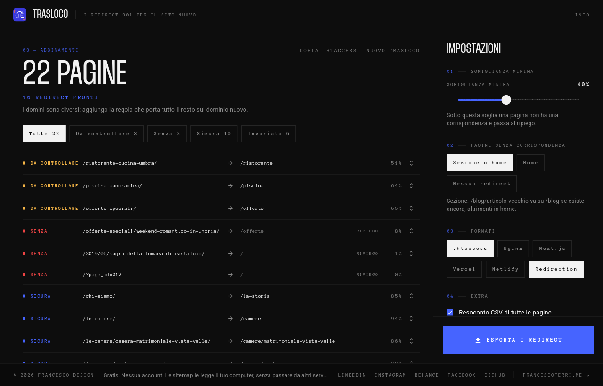
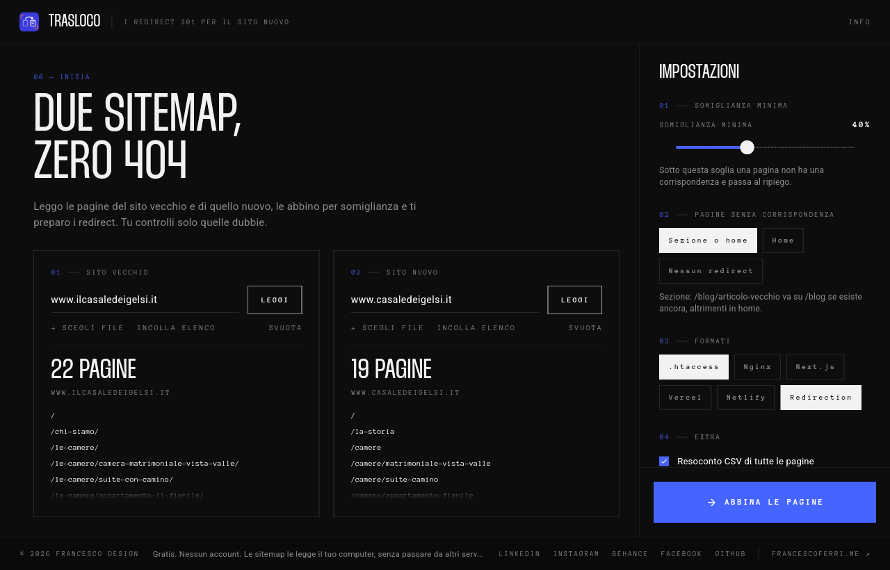

<p align="center">
  
</p>

<h1 align="center">Trasloco</h1>
<p align="center"><strong>I redirect 301 per il sito nuovo.</strong> Un'app gratuita per Mac e Windows di <a href="https://www.francescoferri.me">Francesco Ferri</a>.</p>



## Cosa fa

Rifai il sito di un cliente e gli indirizzi cambiano: `/le-camere/suite-con-camino/` diventa `/camere/suite-camino`.
Se non metti i redirect, Google trova dei 404, i link condivisi negli anni smettono di funzionare e il sito nuovo parte da zero.

Trasloco legge le pagine del sito vecchio e di quello nuovo e le abbina per te:

- **legge le sitemap da sole**: scrivi `sito.it` e trova la sitemap da `robots.txt`, segue gli indici di WordPress, Yoast e Rank Math, apre anche le `.xml.gz`
- **oppure un file**: sitemap `.xml`, un `.txt` con un URL per riga, il CSV di Screaming Frog o un elenco incollato a mano
- **abbina per somiglianza**: parole dell'indirizzo, sezione e lingua. Sa che `chi-siamo` e `la-storia`, `fotogallery` e `galleria`, `rooms` e `camere` sono la stessa pagina
- **non confonde le lingue**: `/en/rooms/` va su `/en/rooms`, non su `/camere`
- **mette in cima quelle dubbie**: ogni pagina ha un punteggio. Tu controlli solo quelle **da controllare** e quelle **senza**, e puoi scegliere un'altra pagina dal menu o scrivere la destinazione a mano
- **ripiego intelligente**: una pagina sparita va nella sua sezione (`/offerte-speciali/weekend` → `/offerte`) o in home
- **salta le pagine invariate** e i redirect che puntano a sé stessi
- **se cambia il dominio** aggiunge la regola che porta tutto il resto sul dominio nuovo

E scrive i redirect per:

| Formato | File |
| --- | --- |
| Apache | `trasloco.htaccess` |
| Nginx | `trasloco-nginx.conf` |
| Next.js | `trasloco-next.config.js` |
| Vercel | `trasloco-vercel.json` |
| Netlify | `trasloco-netlify_redirects` |
| Plugin Redirection di WordPress | `trasloco-redirection.csv` |

più un **resoconto CSV** con tutte le pagine, da tenere o da mandare al cliente.

Le sitemap le scarica il tuo computer, senza passare da altri server. Nessun account, nessun abbonamento.

| I due siti | Gli abbinamenti |
| --- | --- |
|  |  |

## Scaricala

Vai su [Releases](../../releases) e prendi lo zip per il tuo sistema.

- **Mac**: estrai `Trasloco.app` e spostala in Applicazioni. Se al primo avvio macOS la blocca: Impostazioni di Sistema → Privacy e sicurezza → **Apri comunque**.
- **Windows**: estrai la cartella e avvia `trasloco.exe`. Se compare SmartScreen: **Ulteriori informazioni → Esegui comunque**.

## Come si usa

1. Nel riquadro **Sito vecchio** scrivi l'indirizzo e premi **Leggi**. Se il sito vecchio è già offline, trascina la sitemap salvata o il CSV di un crawler.
2. Fai lo stesso con il **Sito nuovo**: va bene anche l'anteprima su Vercel o la sitemap generata in locale.
3. **Abbina le pagine** (`⌘↵` su Mac, `Ctrl+Invio` su Windows).
4. Guarda le righe gialle e rosse, correggi dove serve.
5. Scegli i formati ed **Esporta i redirect**. Oppure premi **Copia** e incolla.

Con il `.htaccess` metti le regole **in cima** al file, prima di quelle di WordPress.

## Compilarla

Serve [Flutter](https://docs.flutter.dev/get-started/install) stable (3.50 o successivo).

```bash
flutter pub get
flutter test
flutter run -d macos      # oppure: -d windows, -d linux
flutter build macos       # build di release
```

Per pubblicare una nuova versione basta un tag: `git tag v1.0.0 && git push --tags`.
La GitHub Action in `.github/workflows/release.yml` crea gli zip per Mac e Windows e li allega alla release.

## Struttura

```
lib/
  main.dart            avvio dell'app
  src/loader.dart      lettura delle sitemap dal web, dai file e dagli elenchi
  src/matcher.dart     normalizzazione, abbinamento, ripieghi ed esportazione
  src/home_page.dart   interfaccia
  src/shell.dart       barra, piè di pagina e finestra Info
  src/widgets.dart     pulsanti, chip e logo
  src/brand.dart       colori, font e link
  src/strings.dart     testi in italiano e inglese
test/
  matcher_test.dart
  fixtures/            due sitemap di prova
```

## Chi l'ha fatta

Sono **Francesco Ferri**, designer e sviluppatore web a Todi.
Progetto siti cuciti sul comportamento reale di chi li usa, così il sito smette di essere un costo e inizia a convertire.

Ho fatto anche [Snella](https://github.com/Francisff97/snella), per preparare foto e video per il web.

**[francescoferri.me](https://www.francescoferri.me)** · [info@francescoferri.me](mailto:info@francescoferri.me)

[LinkedIn](https://www.linkedin.com/in/francescoferri97/) · [Instagram](https://www.instagram.com/fdesign1997) · [Behance](https://www.behance.net/francescodesign97) · [Facebook](https://www.facebook.com/share/14v4FfKoxgz/?mibextid=wwXIfr) · [GitHub](https://github.com/Francisff97)

## Licenza

Codice sotto licenza [MIT](LICENSE). Il font FD Display, il logo FD e l'icona dell'app restano di Francesco Ferri, tutti i diritti riservati.
